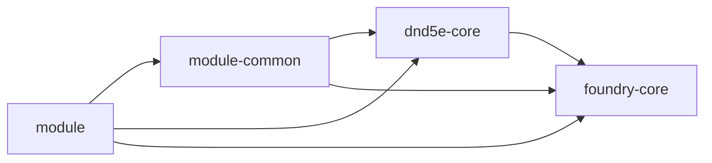

# Architecture and performance

[Wiki home](README.md) · [Lifecycle](lifecycle-and-features.md) · [Types](types-and-conventions.md)

## Workspace boundaries

An arrow means "may depend on":



| Workspace | Put code here when… | Import-time contract |
| --- | --- | --- |
| `foundry-core` | It is a high-value, system-independent Foundry v14 helper or type. | Importing performs no Foundry access or registration. |
| `dnd5e-core` | A concrete, documented need requires changing stable reusable D&D 5e behavior. | Stateless helpers; no automatic rules, hooks, or caches. |
| `module-common` | Project-specific functionality is genuinely shared by downstream module code. | Prefer environment independence and explicit initialization. |
| `module` | It owns lifecycle, settings instances, UI, hooks, and runtime features. | Explicit module bootstrap owns integration work. |

Keep dependencies acyclic. Shared packages must not import a module's lifecycle or settings instance. Each module in a multi-module project owns its own manifest ID and verbose/settings instances. The `namespace` argument to `SettingsUtils.create` remains explicit.

### More than one module

Give each application package its own manifest, `MODULE_ID`, settings facade, verbose controller, and lifecycle entry point. Shared code receives any required module context through ordinary function arguments. A shared mutable `SettingsUtils.configure(id)` would couple otherwise independent modules, so the current factory keeps the namespace explicit.

The shipped root build/release commands target `@template/module` and `dist/module`. Adding another npm workspace does not automatically add its artifact to that release workflow; configure its entry point, output, and release handling explicitly when that requirement exists.

Prefer adapting downstream code over changing `dnd5e-core`. Its partial contracts target Foundry v14 and D&D 5e 6.0.6. Shared convenience alone does not justify moving module-specific behavior into that stable layer.

All workspaces are private. Use npm-compatible dependency versions such as `0.0.0` for the current internal links; the project does not use `workspace:*`. Workspace versions are linking metadata. The root package version alone controls the shipped release version, as described in [Build and release](build-and-release.md).

## Module layout

```text
packages/module/
├── src/
│   ├── main.ts
│   ├── lifecycle.ts
│   ├── module-id.ts
│   ├── settings.ts
│   ├── foundry.d.ts
│   └── features/example/
│       ├── example.ts
│       ├── example.types.d.ts
│       └── example.utils.ts
└── tests/
    ├── main.test.ts
    ├── lifecycle.test.ts
    ├── module-id.test.ts
    ├── settings.test.ts
    └── features/example/.gitkeep
```

`main.ts` wires the host lifecycle. `lifecycle.ts` decides when to initialize behavior. A feature owns its handlers, declarations, and helpers. Split a growing feature when its responsibilities justify it; split lifecycle handlers into separate files only when the phases gain substantial independent logic. The current example feature is an empty structural placeholder.

## Functions and grouped utilities

Implement utilities as standalone exported functions. Native namespace re-exports give a grouped API without a utility class or hand-built singleton container. The core packages already use `export * as ActorUtils from './actor/actor.utils.ts'` and equivalent groups.

```ts
import { ActorUtils, ResourceUtils } from '@template/dnd5e-core';

export function getSelectedCharacterHealth() {
    const actor = ActorUtils.getActiveCharacter();
    return actor ? ResourceUtils.getHitPoints(actor) : null;
}
```

Call this after the world is ready. The actor lookup reads the native assignment and the HP helper reads prepared data. It does not compute D&D rules or mutate an actor.

Stateful objects are appropriate where they provide a concrete benefit: a settings facade ties a schema to a namespace, and a verbose controller encapsulates one module's cached flag. Those factories are explicit calls; importing `foundry-core` itself creates neither instance.

## Runtime priorities

1. Choose the correct lifecycle and use events instead of polling.
2. Reuse prepared system values and maintained indexes, such as `actor.identifiedItems` and native activity lookup.
3. Keep frequent handlers small. Avoid repeated collection scans, DOM writes, document updates, and unnecessary snapshots.
4. Cache expensive work only with correct invalidation. The verbose cache is seeded once and updated by the setting's native `onChange`.
5. Own and release temporary listeners. [Hook helpers](foundry-core/hooks.md) return idempotent cleanup functions.
6. Verify production output when adding a grouped API or dependency. Imports from `lodash-es` should name the used functions; use native JavaScript for trivial operations.

Verified performance outranks stylistic uniformity. Deliberate repetition or unusual implementations require concrete technical reasoning and an explanatory comment. Measure the relevant workload before adding an optimization.

The template deliberately has no service container, generic plugin registry, telemetry, runtime UI framework, or polling infrastructure. Publishing is limited to the explicitly pushed release tags handled by the [GitHub release workflow](build-and-release.md#github-releases). Add functionality for a concrete module feature and keep its lifetime explicit.
